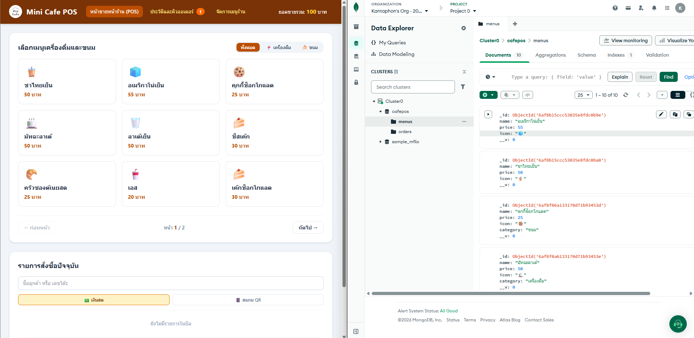
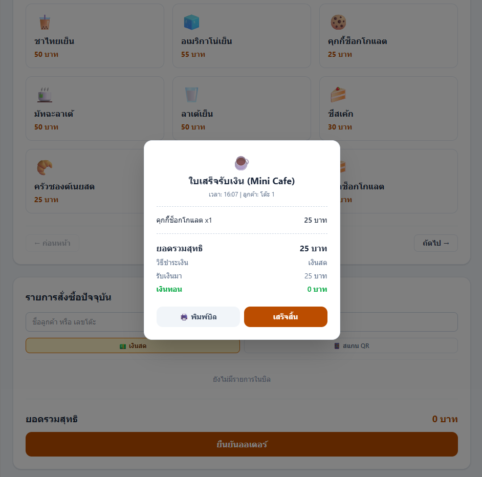
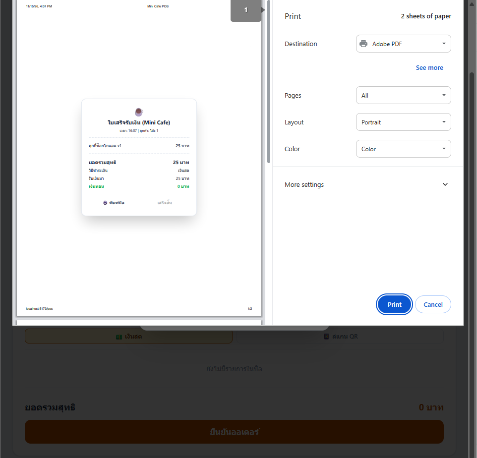
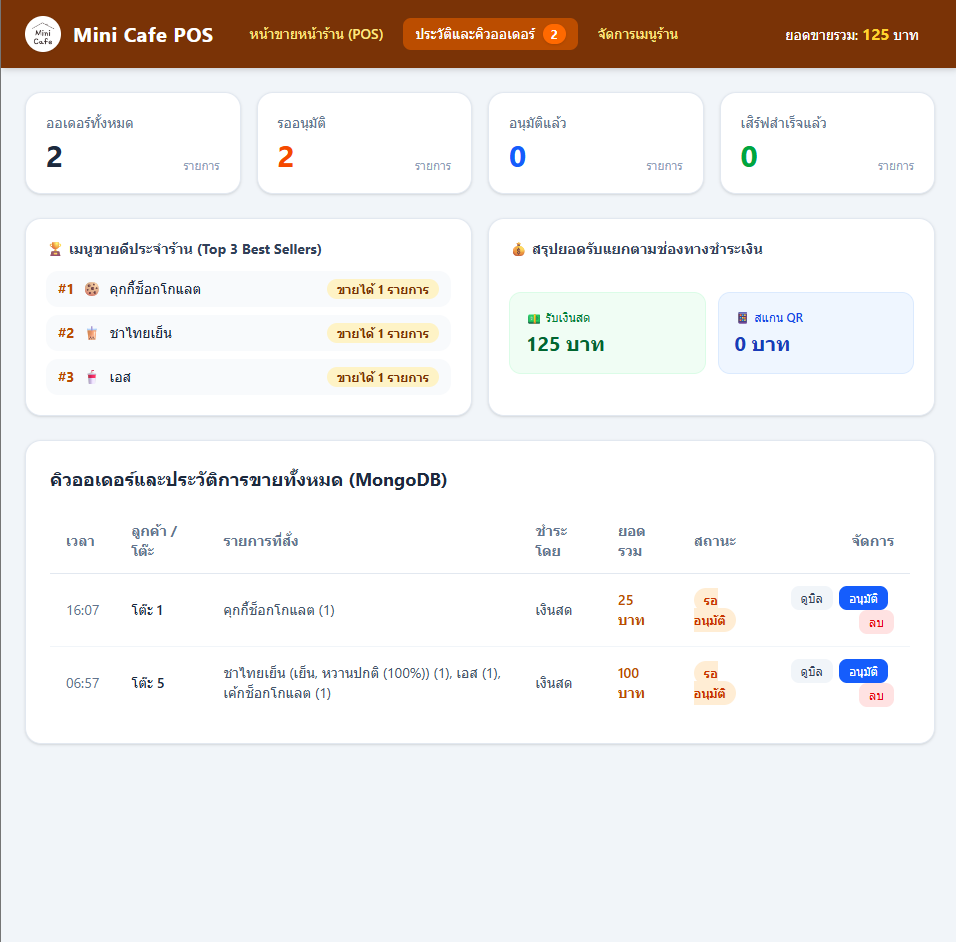
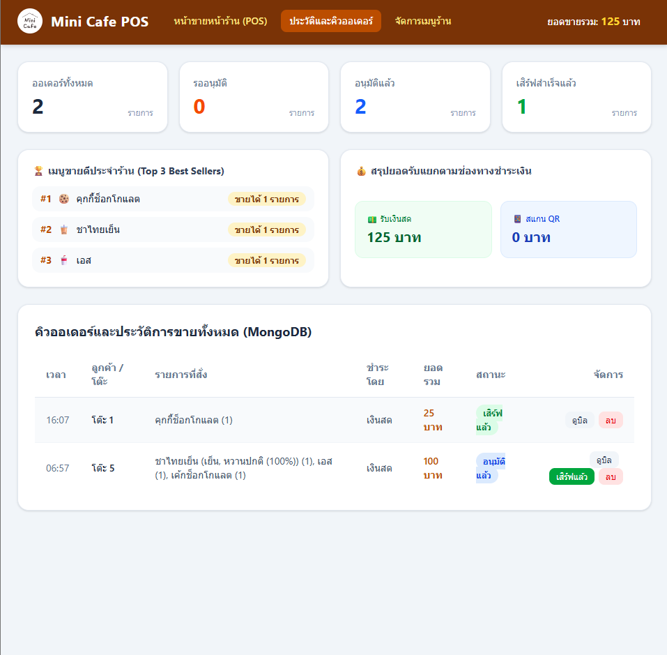
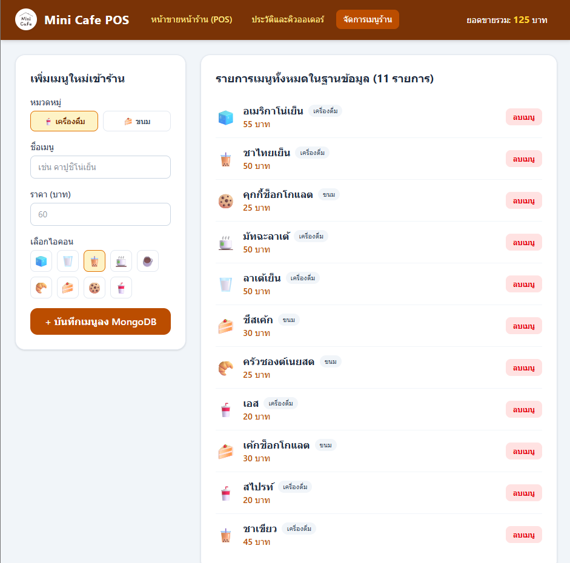
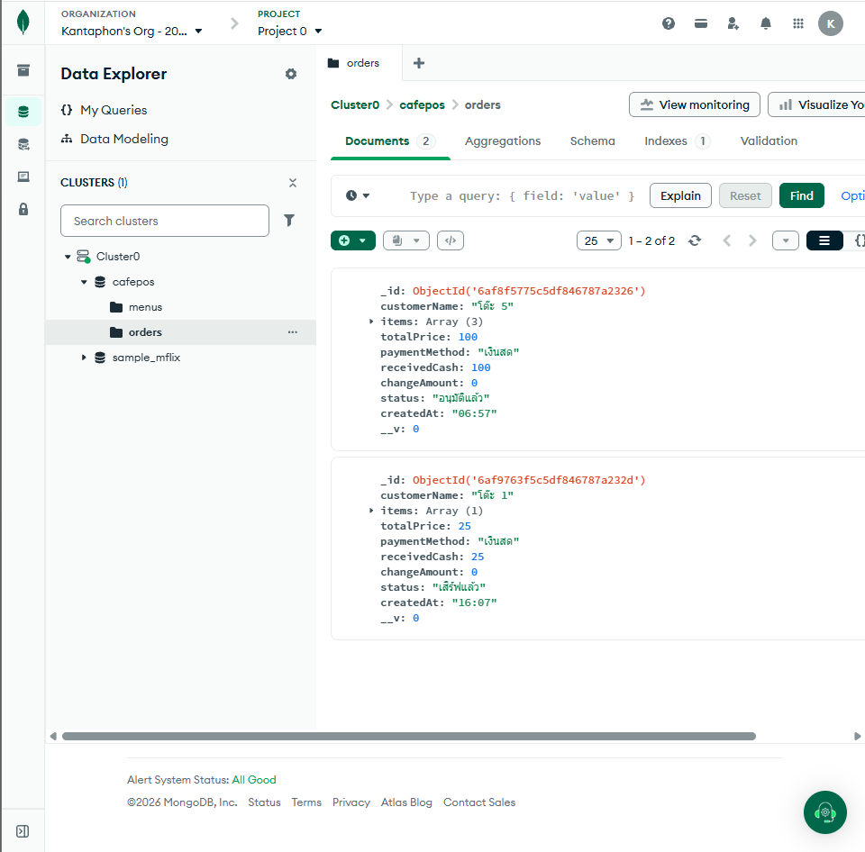

# ☕ Mini Cafe POS — ระบบจัดการการขายหน้าร้านคาเฟ่และคิวออเดอร์

เว็บแอปพลิเคชันระบบขายหน้าร้าน (Point of Sale) สำหรับร้านคาเฟ่ พัฒนาแบบ Full-Stack เพื่อช่วยลดความผิดพลาดในการจดออเดอร์ คำนวณเงินทอนอัตโนมัติ ติดตามสถานะคิวแบบ Real-time และบันทึกข้อมูลลงฐานข้อมูล Cloud

> **จัดทำโดย:** [นายกันตภณ กายดี] (รหัสนักศึกษา: [67110920])
> **รายวิชา:** [CE306 โปรแกรมประยุกต์บนเว็บ]

---

## ✨ ฟีเจอร์หลักของระบบ (Key Features)

* **หน้าขายหน้าร้าน (POS Page `/pos`):**
  * แสดงรายการเมนูแบบตาราง 3x3 (หน้าละ 9 ช่อง) พร้อมระบบเปลี่ยนหน้า (Pagination) และกรองตามหมวดหมู่ (`ทั้งหมด`, `เครื่องดื่ม`, `ขนม`)
  * หน้าต่างเลือกตัวเลือกเครื่องดื่ม (`ร้อน` / `เย็น` / `ปั่น +10 บาท` และระดับความหวาน `100%` / `50%` / `0%`) โดยระบบจะข้ามการถามความหวานให้อัตโนมัติสำหรับเมนูขนมและน้ำอัดลม
  * รองรับการชำระเงินทั้ง **เงินสด** (มีปุ่มรับเงินด่วน `พอดีเป๊ะ`, `100`, `500`, `1000` คำนวณเงินทอนอัตโนมัติ) และ **สแกน QR**
  * ออก **ใบเสร็จรับเงิน (Receipt Pop-up)** ทันทีหลังยืนยันออเดอร์
* **คิวออเดอร์และสรุปยอดขาย (Orders Page `/orders`):**
  * ระบบอัปเดตสถานะการทำงาน 3 ขั้นตอน (`รออนุมัติ` $\rightarrow$ `อนุมัติแล้ว` $\rightarrow$ `เสิร์ฟแล้ว`) พร้อมตัวเลขแจ้งเตือนออเดอร์รออนุมัติบนแถบเมนู
  * สรุป **Top 3 เมนูขายดีประจำร้าน** และยอดรับแยกตามช่องทางชำระเงิน (`เงินสด` vs `สแกน QR`) แบบ Real-time
* **จัดการเมนูร้าน (Menu Management `/menus`):**
  * เพิ่มเมนูใหม่ (กำหนดชื่อ, ราคา, หมวดหมู่, ไอคอน) และลบเมนูออกจากฐานข้อมูล MongoDB ได้ทันที

---

## 🛠️ เทคโนโลยีที่ใช้ (Tech Stack)

* **Frontend:** React, TypeScript, Tailwind CSS, Vite
* **Backend:** Bun, Express.js (RESTful API)
* **Database:** MongoDB Atlas (Mongoose ODM)

---

## 📁 โครงสร้างโปรเจกต์ (Project Structure)

```text
MiniProject_CafePOS/
├── backend/
│   ├── server.js          # Express API และโครงสร้าง Schema ของ MongoDB
│   └── package.json
├── frontend/
│   ├── src/
│   │   ├── components/    # Component ย่อย (MenuCard, CartItemRow, DrinkOptionModal, ReceiptModal ฯลฯ)
│   │   ├── pages/         # หน้าหลัก (PosPage, OrdersPage, MenuManagePage)
│   │   └── App.tsx        # จัดการ Routing และ State หลัก
│   └── package.json
└── README.md







